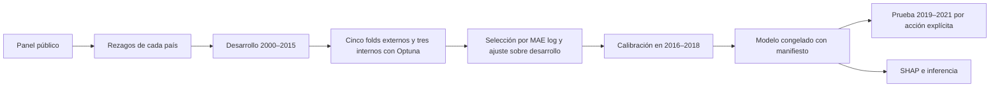

# Guía técnica del entrenamiento SP-06

## Paso 1. Problema y referencia

Objetivo. Estimar a un año la probabilidad nacional de muerte prematura por las cuatro ENT del indicador SH.DYN.NCOM.ZS. El manuscrito SP06_Articulo_Mortalidad_Prematura_Siete_Fases.docx y el CSV público definen la unidad país-año, con 440 filas en 20 países. Los valores ilustrativos del manuscrito quedan fuera del flujo de ejecución. Verifica el origen y la huella en Datos y EDA.

## Paso 2. Elección metodológica

Persistencia devuelve y(t−1). Es el comparador para una serie con continuidad anual y puede perder precisión ante cambios abruptos. Ridge minimiza la suma de los residuos cuadrados en escala logarítmica más α por la norma cuadrática de los coeficientes. Reduce la inestabilidad provocada por rezagos correlacionados, aunque supone una relación lineal en la escala ajustada. Random Forest promedia árboles ajustados sobre muestras bootstrap, permite interacciones y limita el sobreajuste con profundidad y tamaño de hoja. Sus predicciones tienen capacidad limitada de extrapolación. XGBoost añade árboles que corrigen el error del ensamble anterior y controla capacidad con profundidad, número de árboles, tasa de aprendizaje y submuestreo. Requiere mayor control de la búsqueda en un panel pequeño. Comprueba que todas las comparaciones incluyan persistencia y usen los mismos folds.

## Paso 3. Flujo



Comprueba que el motor recibe un artefacto guardado y que la prueba se abre por separado.

## Paso 4. Arquitectura

`app.py` selecciona el flujo Streamlit. `workflow.py` contiene controles, estado de sesión y evaluación final. `protocol_v2.py` valida el panel, crea particiones, instancia modelos, optimiza y calibra. `modeling.py` aporta la preparación compartida. `engine.py` guarda, recupera y predice. `reporting.py` presenta explicaciones y descargas, y `visuals.py` aporta SHAP y gráficos reutilizables. `test_training.py` prueba el contrato entre estos módulos.

## Paso 5. Datos y particiones

`read_data` comprueba claves, años y porcentajes. `prepare` conserva los tres años previos consecutivos de cada país y aplica log1p al objetivo. `split_panel` asigna años completos y, en el panel público, deja 260, 60 y 60 objetivos elegibles. `outer_partitions` asigna 16 países y objetivos de 2003–2012 al ajuste, con cuatro países distintos y objetivos de 2013–2015 en cada evaluación externa. Los rezagos de los países excluidos se usan como observaciones previas disponibles. En prueba se simula un año por paso con observaciones previas, incluidas las ya conocidas del mismo bloque. Verifica fechas y países en el panel previo al entrenamiento.

## Paso 6. Algoritmos y configuración

`SPACES` define α de 0,001 a 100 para Ridge con escalamiento dentro del pipeline. Para Random Forest permite 100–400 árboles, profundidad 2–8 y 2–10 muestras por hoja. Para XGBoost permite 50–300 árboles, profundidad 2–4, tasa 0,01–0,15 y submuestreo 0,70–1. La tasa y α se exploran en escala logarítmica. Configura los rangos en Optuna y verifica los parámetros elegidos en los resultados por fold.

## Paso 7. Validación anidada

Cada estudio TPE utiliza tres grupos internos de países y minimiza el promedio de MAE log. La semilla inicial es 606. MedianPruner compara resultados parciales después del periodo inicial. El ajuste externo usa todos los datos autorizados del fold y evalúa el bloque externo una vez. El candidato se selecciona por menor MAE log medio entre modelos entrenados. Después se repite la búsqueda interna con todo desarrollo y se ajusta el modelo final. El timeout puede modificar el número efectivo de ensayos. Para comparar reproducciones, usa el mismo presupuesto de trials que se completó, las mismas versiones y la misma semilla.

## Paso 8. Interfaz

Abre Entrenamiento de modelos de IA para revisar la partición, los modelos activos y el presupuesto. Edita modelos, rangos y ensayos en Optuna. Inicia desde cualquiera de ambas vistas. La interfaz actualiza el modelo, fold y estado del ensayo, y conserva el historial y los eventos del ajuste. El cálculo se ejecuta en la sesión que lo inicia.

## Paso 9. Resultados de desarrollo

Selecciona MAE log, MAE en puntos porcentuales, RMSE o MASE. La media y la desviación estándar describen cinco folds, y el gráfico muestra los puntos individuales. Para MASE externo se usa el error medio de persistencia del conjunto de ajuste como escala común porque los países evaluados están excluidos de ese conjunto. La prueba final usa escala por país derivada del desarrollo. Revisa los gráficos junto con Interpretabilidad y Explicación y descarga el historial de Optuna para comparar configuraciones.

## Paso 10. Persistencia

La corrida guarda el modelo, la huella del dataset, el calendario, los parámetros, la semilla, las versiones y los tiempos registrados. El motor usa JSON nativo para XGBoost y Skops para los modelos de scikit-learn creados localmente. El guardado usa un directorio temporal y publica la corrida completa mediante un cambio de nombre. Comprueba la recuperación seleccionando el mismo ID después de reiniciar Streamlit.

## Paso 11. Pruebas

Desde la raíz del proyecto ejecuta los siguientes comandos en PowerShell.

```powershell
.\.venv\Scripts\python -m pip install -r sp06_crisp/requirements.txt
.\.venv\Scripts\python -m unittest discover -s sp06_crisp -p test_training.py
.\.venv\Scripts\python -m streamlit run sp06_crisp/app.py --server.address 127.0.0.1 --server.port 8502
```

Las pruebas comprueban los tamaños, la separación temporal y geográfica, la independencia de las variables de desarrollo ante cambios futuros, la escala MASE y la equivalencia del pronóstico antes y después de recuperar el modelo. Para verificar la interfaz, entrena una corrida corta y comprueba que la evaluación reservada requiere una acción explícita.

## Paso 12. Integración

Evaluación calcula métricas sobre 2019–2021 solo al abrir la prueba. La banda usa el percentil empírico 90 de los errores de 2016–2018 y su cobertura debe medirse en la prueba. Explicabilidad usa desarrollo para SHAP global y un país-año para SHAP local. Motor requiere tres rezagos observados y carga la corrida guardada. Reportes hereda los resultados y la procedencia de la corrida. Estas salidas son poblacionales y corresponden a la versión histórica del indicador.
